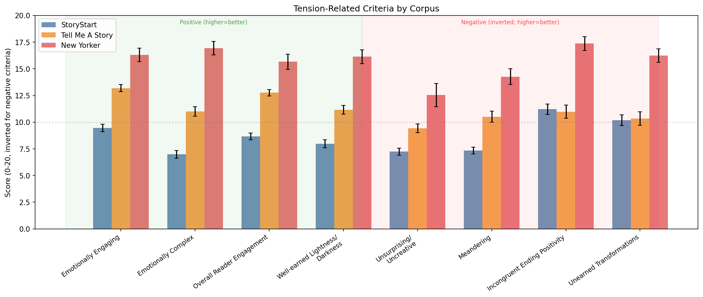
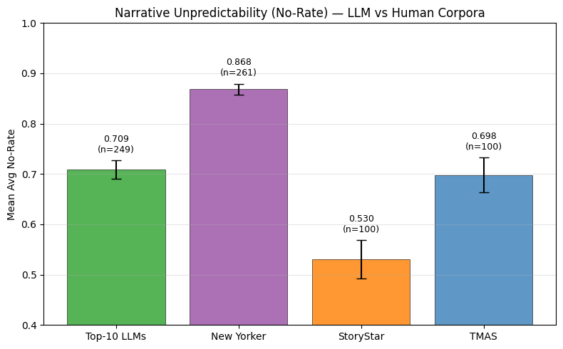
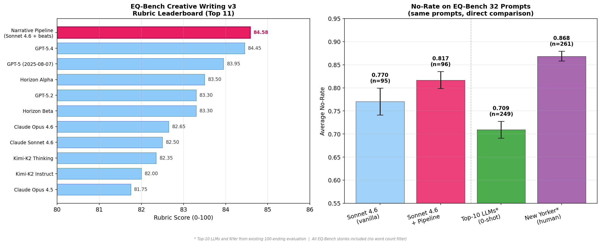
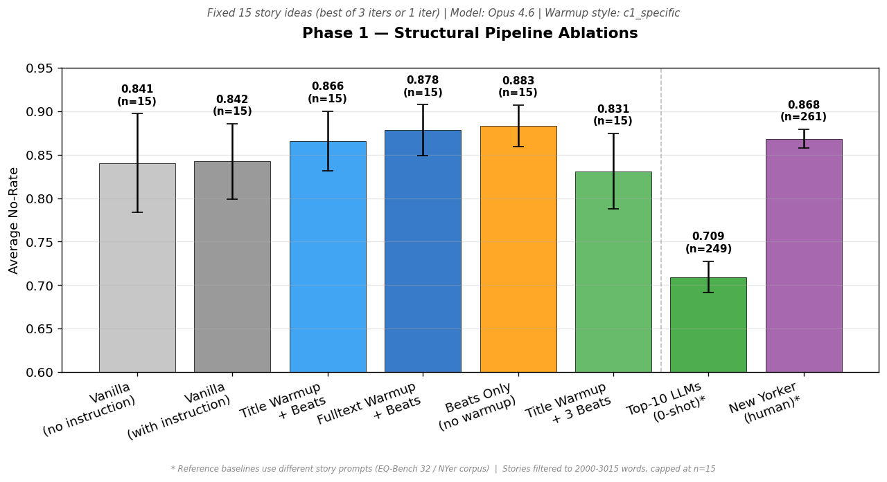
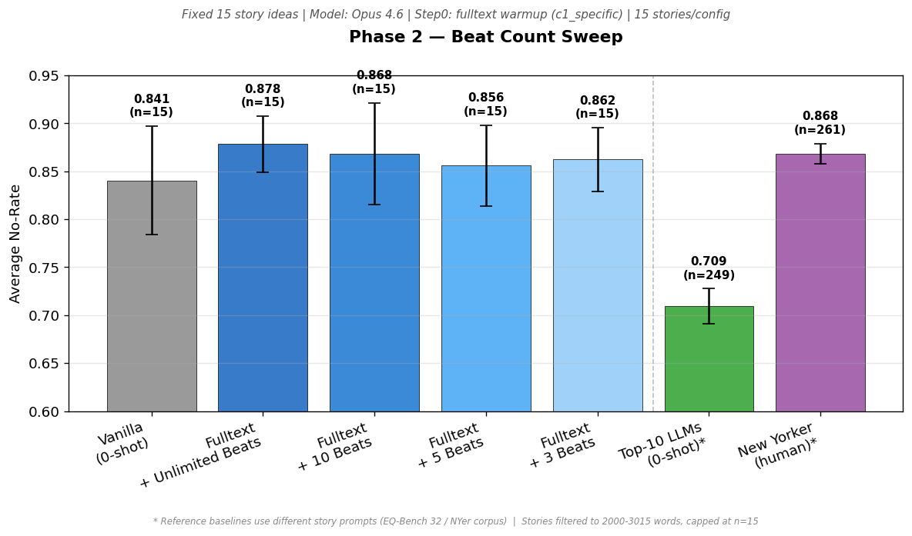
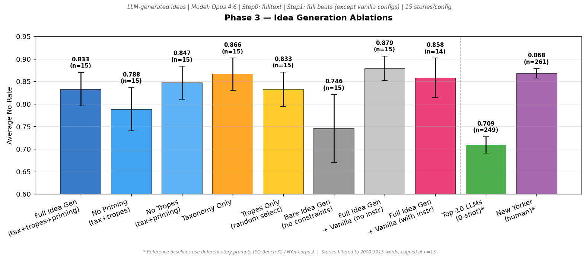

# Measuring Narrative Tension in LLM-Generated Fiction: A 100-Ending Evaluation

## 1. The Puzzle: What Makes Great Stories Great?

EQ-Bench Creative Writing v3 is a widely used benchmark for evaluating LLM-generated fiction. Its rubric scores stories on 22 rubric criteria — adherence to instructions, character believability, prose quality, emotional complexity, and others — using Claude Sonnet 4 as judge. We applied this rubric to three human-written story corpora of varying quality:

| Corpus | EQ-Bench Rubric Score (0–100) | n |
|---|---|---|
| New Yorker (professional literary fiction) | 78.71 | 30 |
| Tell Me a Story (amateur, curated) | 60.89 | 41 |
| StoryStar (amateur, uncurated) | 44.25 | 100 |

The rubric correctly orders the corpora by quality: New Yorker > Tell Me a Story > StoryStar. However, New Yorker stories (78.71) do not even reach the top 10 of the EQ-Bench leaderboard, where LLMs score 81–84:

| Model | Rubric Score |
|---|---|
| GPT-5.4 | 84.45 |
| Claude Sonnet 4.6 | 82.50 |
| Claude Opus 4.5 | 81.75 |
| ... | ... |
| New Yorker (human) | 78.71 |

This is surprising. In EQ-Bench, the LLMs generate stories using zero-shot prompting — no iterative revision, no feedback, no human-in-the-loop refinement. It is difficult to believe that these zero-shot outputs are genuinely better than professionally edited New Yorker fictions across all dimensions of quality.

The more likely explanation is that the EQ-Bench rubric captures important but incomplete aspects of fiction quality — prose fluency, character consistency, emotional engagement — while missing something that distinguishes professional literary fiction from competent LLM outputs or human amateurs. We hypothesize that one of the missing dimensions is **narrative tension**: the degree to which a story's progression violates reader's expectation, where what comes next cannot be easily anticipated from what came before.

*Figure 1: EQ-Bench rubric criteria scores across three human-written corpora.*

## 2. The 100-Ending Metric

To measure narrative tension, we develop a position-level evaluation based on counterfactual story continuations.

**Procedure.** At each sentence position *i* in a story of *N* sentences, we provide sentences 1..*i* as context and prompt a language model (Qwen3-32B, T=1.2) to generate 100 possible next-sentence endings. A judge model (Qwen3-8B, T=0) then evaluates each ending: does the event described in this ending actually occur in the true continuation (sentences *i*+1..*N*)? We report **no-rate**: the fraction of 100 endings that do *not* match the actual continuation.

A no-rate of 0.90 means 90 of 100 generated endings fail to predict what actually happens — the story is highly unpredictable at that point. We average no-rate across all evaluated positions (10%–99% of story progress) and then across stories.

**Validation.** We evaluated four groups using this metric:

| Group | Mean No-Rate | ±95% CI | n |
|---|---|---|---|
| New Yorker (professional) | 0.868 | 0.011 | 261 |
| Top-10 LLMs (EQ-Bench, 0-shot) | 0.709 | 0.018 | 249 |
| Tell Me a Story (amateur) | 0.698 | 0.035 | 100 |
| StoryStar (amateur) | 0.530 | 0.038 | 100 |

The ordering is consistent with our intuition: professional fiction is the least predictable, amateur fiction the most. Notably, the top-10 LLMs (0.709) is on par with the better amateur corpora rather than with New Yorker fiction — despite scoring *higher* than New Yorker on the EQ-Bench rubric. This suggests that the 100-ending metric may capture a dimension of quality that EQ-Bench misses: LLM stories are rhetorically polished but do not skillfully play with the reader's expectations.

*Figure 2: Average no-rate across four story groups. Higher = less predictable. New Yorker fiction is substantially less predictable than both LLM-generated and amateur human stories.*

## 3. Can a Story Pipeline Improve Both Metrics?

We test whether a structured story generation pipeline can improve narrative tension while maintaining or improving rubric quality. The pipeline has three steps:

1. **Warmup** (Step 0): The LLM reads a reference story and extracts a structural beat sheet.
2. **Beat Adaptation** (Step 1): The beat sheet is adapted to the target story idea.
3. **Story Writing** (Step 2): The LLM writes the story following the adapted beats.

We applied this pipeline to Claude Sonnet 4.6 on the standard EQ-Bench 32 story prompts and evaluated both metrics:

**EQ-Bench Rubric Score:**

| Model | Rubric Score (0–100) |
|---|---|
| **Sonnet 4.6 + Pipeline** | **84.58** |
| GPT-5.4 | 84.45 |
| GPT-5 (2025-08-07) | 83.95 |
| Claude Sonnet 4.6 (vanilla) | 82.50 |

The pipeline places Sonnet 4.6 at #1 on the rubric leaderboard (84.58), above GPT-5.4 (84.45) and a slight improvement over vanilla Sonnet 4.6 (82.50).

**100-Ending No-Rate (same 32 EQ-Bench prompts):**

| Config | No-Rate | ±95% CI | n |
|---|---|---|---|
| Sonnet 4.6 (vanilla, 0-shot) | 0.770 | 0.029 | 95 |
| Sonnet 4.6 + Pipeline | 0.817 | 0.018 | 96 |

On the same 32 EQ-Bench prompts, the pipeline improves no-rate by +0.047 (0.770 → 0.817). This is a moderate effect — the pipeline stories are less predictable than vanilla, though still below New Yorker fiction (0.868). Combined with the rubric improvement (+2.08 points, reaching #1), the pipeline improves both dimensions simultaneously: stories that maintain EQ-Bench quality metric, but that are also harder to predict.

*Figure 4: Left — EQ-Bench rubric leaderboard with our pipeline at #1 (84.58). Right — No-rate on the same 32 prompts. The pipeline improves both rubric quality and narrative tension over vanilla Sonnet 4.6.*

## 4. Ablation Study: What Creates Narrative Tension?

To understand which exact pipeline components contribute to narrative tension, we conducted a systematic ablation across 17 configurations organized in three phases. Due to cost constraints, this ablation uses only the 100-ending metric (not EQ-Bench rubric scoring which uses API calls). All stories are generated by Claude Opus 4.6 on a set of 15 story ideas.

### Statistical Note

All results are from n=15 stories per configuration, story length between 2000–3015 words. With this sample size, 95% CIs are ±0.03–0.05. **We only draw conclusions from gaps exceeding 0.05.**

### Complete Results

| Config | No-Rate | ±95% CI | Phase |
|---|---|---|---|
| `vanilla` (no instruction) | 0.840 | 0.057 | 1 |
| `instruction_vanilla` | 0.842 | 0.043 | 1 |
| `short_beats` (title + 3 beats) | 0.831 | 0.044 | 1 |
| `full_title` (title + beats) | 0.866 | 0.035 | 1 |
| `full_fulltext` (fulltext + beats) | 0.879 | 0.029 | 1 |
| `no_warmup` (beats from scratch) | 0.883 | 0.024 | 1 |
| `fulltext_beats3` | 0.862 | 0.033 | 2 |
| `fulltext_beats5` | 0.856 | 0.042 | 2 |
| `fulltext_beats10` | 0.868 | 0.053 | 2 |
| `idea_bare` | 0.746 | 0.075 | 3 |
| `idea_no_priming` | 0.788 | 0.048 | 3 |
| `idea_tropes_only` | 0.833 | 0.038 | 3 |
| `idea_full` | 0.833 | 0.037 | 3 |
| `idea_no_tropes` | 0.847 | 0.036 | 3 |
| `idea_instruction_vanilla` | 0.858 | 0.044 | 3 |
| `idea_tax_only` | 0.866 | 0.036 | 3 |
| `idea_vanilla` | 0.879 | 0.027 | 3 |

### Phase 1: Structural Pipeline (fixed story ideas)

**Controlled for:** 15 story ideas (synthetically generated, high quality) | Model: Opus 4.6

Adding a writing instruction to vanilla makes no measurable difference (0.840 → 0.842). Warmup source (title vs. full text vs. none) produces differences within noise. These story ideas were generated by our full idea-generation pipeline and are already structurally rich — the warmup step adds little on top. This finding may not generalize to weaker prompts.

*Figure 5: Phase 1 — Structural pipeline ablations. All configs use the same 15 fixed story ideas.*

### Phase 2: Beat Count Sweep (fixed story ideas)

**Controlled for:** 15 story ideas | Step 0: fulltext warmup

With step 0 held constant, varying the beat count (3, 5, 10, unlimited) produces no significant differences (all within 0.856–0.879). On these story ideas, any reasonable number of beats yields comparable tension.

*Figure 6: Phase 2 — Beat count sweep. Step 0 = fulltext warmup held constant.*

### Phase 3: Idea Generation Ablations

**Controlled for:** Opus 4.6 | Step 0: fulltext warmup | Step 1: full beats (except vanilla configs)

The idea-generation pipeline has three independently ablatable components:
- **Taxonomy**: Random 7-level structural profile from the Screenwriters Taxonomy (genre, voice, pathway, POV)
- **Tropes**: Concrete narrative devices sampled from a trope database, LLM-curated to match the taxonomy
- **Genre Priming**: LLM pre-analyzes 5 random taxonomy profiles to activate narrative reasoning

#### Finding 1: Unconstrained idea generation produces the lowest-tension stories

`idea_bare` (0.746) — the LLM generating ideas with no constraints — is 0.09 below the next-lowest configuration. This is the clearest signal in the study. An LLM asked to simply produce a story idea falls back on its most probable narrative templates, which are exactly what the 100-ending judge finds predictable.

#### Finding 2: Content-level constraints (tropes) reduce tension

Comparing configurations that differ only in trope inclusion:

| With tropes | Without tropes | Gap |
|---|---|---|
| `idea_no_priming` (0.788) | `idea_tax_only` (0.866) | 0.078 |
| `idea_full` (0.833) | `idea_no_tropes` (0.847) | 0.014 |

Removing tropes consistently improves no-rate. The effect is largest when priming is absent (0.078 gap). Tropes are content-level constraints — they specify concrete plot devices ("a festival masks a deadly ritual"). The LLM maps these to more familiar narrative patterns, producing stories whose events are predictable.

#### Finding 3: Form-level constraints (taxonomy) increase tension

| Config | No-Rate | Constraint type |
|---|---|---|
| `idea_bare` | 0.746 | None |
| `idea_tax_only` | 0.866 | Taxonomy only |

A 0.12 gap — the largest effect size in the study. The Screenwriters Taxonomy constrains *how* a story is told (genre, voice, POV, narrative pathway) without specifying *what* happens. Unusual sampled combinations like "Horror + Bromance + Stream of Consciousness + Defeated Underdogs" force the model into genre territory it cannot solve with default patterns. 

This suggests a general principle: **constraints on narrative form increase tension; constraints on narrative content decrease it.** Possible interpretation: The effective creative scaffolding specifies *how* to tell a story, not *what* story to tell.

*Figure 7: Phase 3 — Idea generation ablations. All configs use LLM-generated ideas with fulltext warmup + full beats (except vanilla configs).*

## Supported Hypotheses

We report only hypotheses supported by gaps exceeding 0.05 (our noise threshold at n=15).

**H1: Unconstrained LLM idea generation produces low-tension stories.**
Supported (gap = 0.09). `idea_bare` (0.746) vs. next-lowest (0.788).

**H2: Content-level constraints (tropes) reduce narrative tension.**
Supported (gap = 0.078). `idea_no_priming` (0.788) vs. `idea_tax_only` (0.866).

**H3: Form-level constraints (taxonomy) increase narrative tension.**
Supported (gap = 0.12). `idea_bare` (0.746) vs. `idea_tax_only` (0.866).

**H4: Adding more idea-generation components does not improve tension.**
Supported. `idea_tax_only` (0.866) ≥ `idea_full` (0.833). The full pipeline (taxonomy + tropes + priming) scores lower than taxonomy alone, consistent with H2: adding content-level constraints (tropes) offsets the benefit of form-level constraints (taxonomy).
